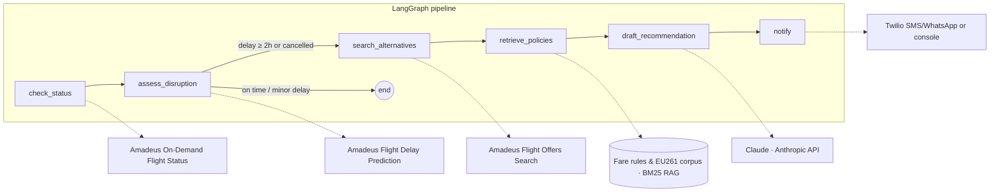

# ✈️ Travel Disruption Agent — built on Amadeus Self-Service APIs

[](https://github.com/Thaynabarreiro/amadeus-disruption-agent/actions/workflows/ci.yml)
[](https://www.python.org/)
[](LICENSE)

An **agentic assistant for flight disruptions**: it monitors a flight through the
[Amadeus Self-Service APIs](https://developers.amadeus.com), detects delays and
cancellations, searches rebooking alternatives, grounds passenger entitlements
(EU261, carrier rebooking policies) with **RAG**, and sends the traveller a clear,
actionable message — automatically.

```
╭───────────────────────── 📱 Passenger notification ─────────────────────────╮
│ Your flight AF1234 NCE->CDG is delayed by 3h10.                             │
│                                                                             │
│ Here are your best rebooking options (earliest arrival first):              │
│   1. AF6205 NCE->CDG dep 16:00 arr 17:35 (96.00 EUR) — 5 seats left         │
│   2. AF6240 NCE->CDG dep 18:30 arr 20:05 (112.00 EUR) — 9 seats left        │
│   3. A53766 NCE->CDG dep 19:15 arr 20:50 (88.00 EUR) — 3 seats left         │
│                                                                             │
│ Based on the applicable rules, rebooking is free of charge and you are      │
│ likely eligible for care and compensation (sources: duty_of_care_matrix,    │
│ eu261_passenger_rights).                                                    │
╰─────────────────────────────────────────────────────────────────────────────╯
```

## Why this project

Disruption handling is one of the highest-cost, highest-friction moments in travel.
This project shows how an **LLM-orchestrated agent** can compress "flight delayed →
call centre queue → manual rebooking" into a single proactive notification, while
staying **safe and auditable**: the LLM only phrases verified facts; every entitlement
it mentions is grounded in a retrieved policy passage with a named source.

## Architecture



**Design decisions**

| Decision | Rationale |
|---|---|
| LLM drafts, never decides | Rebooking options, delay thresholds and entitlements come from APIs and retrieval; the LLM only turns verified facts into a passenger message. No hallucinated flights or promises. |
| Grounded entitlements | Every compensation/care claim cites a retrieved policy passage (EU261, carrier policy) by source. The duty-of-care matrix encodes "likely eligible" phrasing rules. |
| Mock/live parity | `MockAmadeusClient` and `MockLLM` mirror the live response shapes, so the full pipeline runs offline — in CI, in interviews, on a plane. `AGENT_MODE=live` swaps the data source, not the behaviour. |
| BM25 for this corpus | Policy documents are small, keyword-dense and legally precise; lexical retrieval is accurate, deterministic and auditable here. The `PolicyRetriever` interface is the seam where a vector store (ChromaDB + embeddings) plugs in for larger corpora. |
| Graceful degradation | Delay Prediction is best-effort: if the endpoint fails, the agent continues with observed status only. |
| 2h actionability threshold | Matches the EU261 right-to-care boundary, encoded in `DisruptionEvent.actionable`. |

More detail in [docs/ARCHITECTURE.md](docs/ARCHITECTURE.md).

## Quickstart (no credentials needed)

```bash
git clone https://github.com/Thaynabarreiro/amadeus-disruption-agent
cd amadeus-disruption-agent
python -m venv .venv && source .venv/bin/activate
pip install -e ".[dev]"

disruption-agent demo            # runs on-time / delay / cancellation scenarios offline
pytest                           # 22 tests, all offline
```

Or with Docker:

```bash
docker build -t disruption-agent . && docker run --rm disruption-agent
```

## Live mode (Amadeus test environment + Claude)

1. Create free Self-Service keys at [developers.amadeus.com](https://developers.amadeus.com).
2. `cp .env.example .env` and fill in `AMADEUS_CLIENT_ID`, `AMADEUS_CLIENT_SECRET`,
   `ANTHROPIC_API_KEY`, and set `AGENT_MODE=live`.
3. Monitor a real flight:

```bash
disruption-agent monitor AF 1234 --date 2026-07-10
```

Optional: set the `TWILIO_*` variables to deliver the notification via SMS/WhatsApp
instead of the console.

## Project layout

```
src/disruption_agent/
├── agent/            # LangGraph pipeline (nodes, routing, state)
├── amadeus/          # Amadeus Self-Service client (OAuth2) + mock with fixture parity
├── rag/              # Policy retriever (section chunking + BM25)
├── llm.py            # Claude integration + deterministic mock, grounding prompt
├── notify.py         # Twilio / console notifiers
├── cli.py            # Typer CLI (demo, monitor)
├── config.py         # Pydantic settings (.env)
└── data/             # Bundled policy corpus: EU261, carrier rebooking, duty-of-care
tests/                # 22 offline tests: units, HTTP contract (respx), e2e graph
```

## Testing strategy

- **Unit**: delay computation, actionability thresholds, retrieval ranking.
- **HTTP contract**: `LiveAmadeusClient` against mocked Amadeus responses (respx) —
  OAuth token caching, timing parsing, graceful degradation on 4xx.
- **End-to-end**: the compiled LangGraph run for all three scenarios, asserting the
  final message contains the earliest-arrival option and cites its policy sources —
  and that an on-time flight sends **no** notification.

## Companion project: MCP server

This agent's data layer also powers **[amadeus-mcp-server](https://github.com/Thaynabarreiro/amadeus-mcp-server)** —
an open-source MCP server that exposes the same Amadeus tools (flight status, delay
prediction, flight search, passenger rights) to Claude and any MCP client, including a
`handle_disruption` tool that runs this entire pipeline on demand. The two compose:
this repository is the **automation** (proactive, end-to-end), the MCP server is the
**interface** (conversational, on demand) — one shared core, two delivery surfaces.

## Roadmap

- [ ] Continuous monitoring daemon (poll schedules, webhook triggers)
- [ ] Two-way conversation: passenger replies "option 2" → booking flow via Flight Create Orders
- [ ] Vector retrieval backend (ChromaDB) behind `PolicyRetriever` for larger corpora
- [ ] LLM output evaluation harness (groundedness / faithfulness scoring in CI)

---

Built by [Thayná Barreiro](https://www.linkedin.com/in/thaynabarreiroqs) · MIT License.
*Not affiliated with Amadeus IT Group; uses the public Amadeus for Developers Self-Service APIs.*
