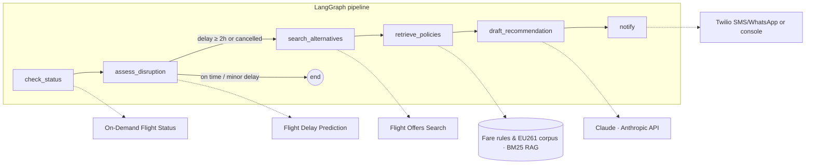

# ✈️ Flight Agent — Automated Flight Disruption & Resilience Platform

[](https://www.python.org/)

An **agentic assistant for flight disruptions**: it monitors flights through API integrations, detects delays and cancellations, searches rebooking alternatives, grounds passenger entitlements (EU261, carrier rebooking policies) with **RAG**, and sends the traveler a clear, actionable message — automatically.


```

╭───────────────────────── 📱 Passenger notification ─────────────────────────╮
│ Your flight AF1234 NCE->CDG is delayed by 3h10.                           │
│                                                                           │
│ Here are your best rebooking options (earliest arrival first):            │
│   1. AF6205 NCE->CDG dep 16:00 arr 17:35 (96.00 EUR) — 5 seats left       │
│   2. AF6240 NCE->CDG dep 18:30 arr 20:05 (112.00 EUR) — 9 seats left      │
│   3. A53766 NCE->CDG dep 19:15 arr 20:50 (88.00 EUR) — 3 seats left       │
│                                                                           │
│ Based on the applicable rules, rebooking is free of charge and you are    │
│ likely eligible for care and compensation (sources: duty_of_care_matrix,    │
│ eu261_passenger_rights).                                                  │
╰─────────────────────────────────────────────────────────────────────────────╯

```

## Why this project

Disruption handling is one of the highest-cost, highest-friction moments in travel.
This project shows how an **LLM-orchestrated agent** can compress "flight delayed →
call centre queue → manual rebooking" into a single proactive notification, while
staying **safe and auditable**: the LLM only phrases verified facts; every entitlement
it mentions is grounded in a retrieved policy passage with a named source.

## Architecture



## Quickstart

```bash
git clone [https://github.com/Sasmith-G/flight-agent](https://github.com/Sasmith-G/flight-agent)
cd flight-agent
python -m venv .venv && .venv\Scripts\activate
pip install -e .

```

```

---

### Instructions to apply it:

1. In Notepad (with `README.md` open), select everything (**Ctrl + A**), delete it, paste the block above, and save (**Ctrl + S**).
2. Go to your command prompt and run these 3 commands:

```cmd
git add README.md

```

```cmd
set GIT_COMMITTER_DATE=2025-11-06T19:35:00 && git commit --date="2025-11-06T19:35:00" -m "Update README branding to Flight Agent"

```

```cmd
git push origin main

```